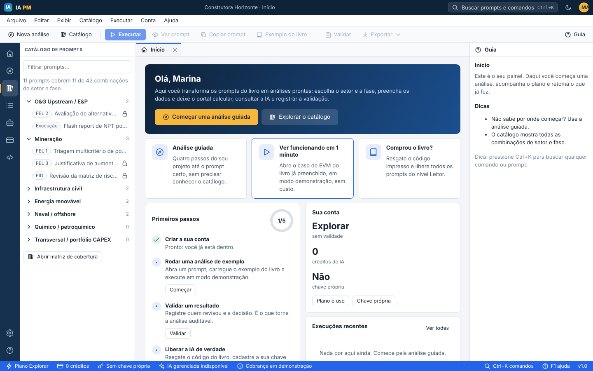
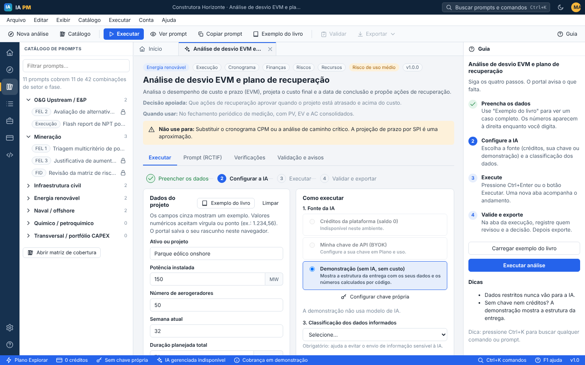
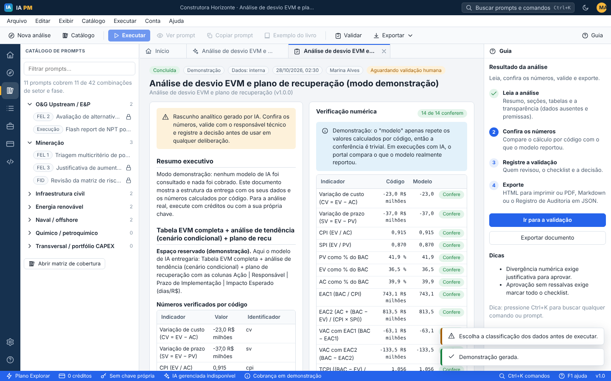
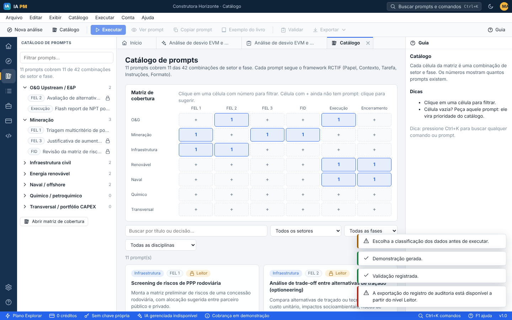
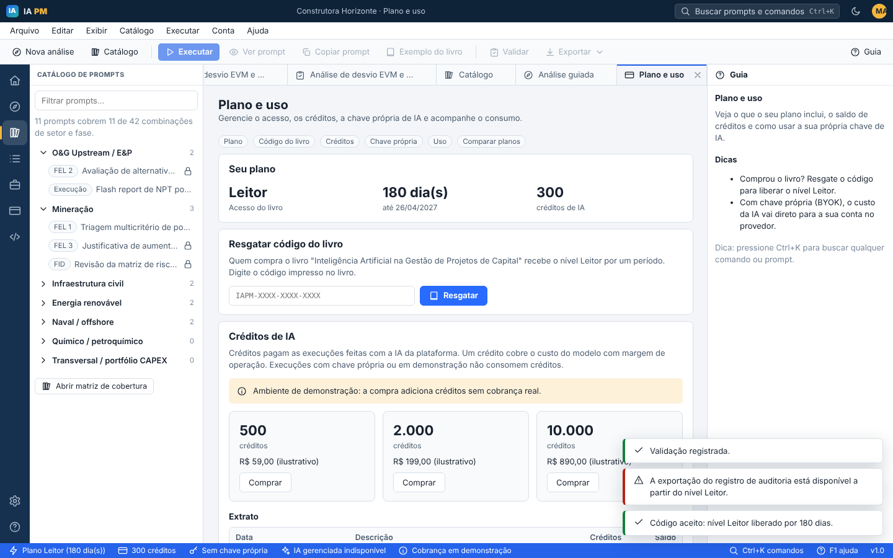

# IA PM (IA Project Management)

Portal SaaS do livro *Inteligência Artificial na Gestão de Projetos de Capital*. Transforma os prompts do livro em um catálogo executável, organizado por **setor**, **fase** e **disciplina**, com **números calculados por código**, **validação humana** e **Registro de Auditoria de IA**. Funciona como um aplicativo de desktop no navegador (menus, abas, atalhos, painel de guia, paleta de comandos) e também por **API REST**.



## O que está pronto

| Trilha | O que entrega |
|---|---|
| **A. Biblioteca e serviços** | Catálogo dos 11 prompts do livro (matriz de cobertura de 7 setores × 6 fases, 42 combinações), análise guiada em 4 passos, busca por setor, fase e disciplina, "pedir um prompt" para células vazias, vitrine de 7 serviços de PMO e consultoria com formulário de proposta, acesso **Leitor** liberado por código impresso no livro (período configurável). |
| **B. Plataforma executável** | Formulário por prompt com validação, números calculados ao vivo, execução com saída estruturada, **conferência** do que o modelo reportou contra o cálculo por código, validação humana com checklist, exportação (HTML para PDF, Markdown, JSON de auditoria), API com chaves, uso e créditos. |
| **Custo da IA** | **BYOK** (chave própria do cliente, cifrada) e **créditos gerenciados** (chave da plataforma, com margem-alvo configurável), mais modo **demonstração** sem custo. |
| **Governança** | Classificação obrigatória dos dados (dados restritos não vão à IA), classificação de risco de uso por prompt, salvaguardas de plataforma em todo prompt, trilha de auditoria, política por organização, retenção configurável. |
| **Multiusuário** | Organizações, convites, papéis (administrador e membro), planos (Explorar, Leitor, Equipe, Corporativo), painel da equipe da plataforma (códigos do livro, solicitações, usuários). |

| Tela | |
|---|---|
|  |  |
|  |  |

## O que depende de você

O código está completo e testado, mas há decisões e contratos que ele não pode tomar. A lista detalhada, com o ponto exato do código para cada item, está em [docs/IMPLANTACAO.md](docs/IMPLANTACAO.md).

1. **Chave de IA** da conta da plataforma (para os créditos) e a decisão de preços (os valores atuais são hipóteses).
2. **Gateway de pagamento.** Hoje o modo `demo` ativa planos e créditos sem cobrança. Em produção use `IAPM_BILLING_MODE=disabled` até integrar.
3. **Domínio e hospedagem** (recomendado: Google Cloud Run com PostgreSQL; veja o guia).
4. **Textos jurídicos** (Termos de Uso, Política de Privacidade com LGPD).
5. **E-mail transacional** (convites e redefinição de senha).
6. **Revisão técnica do conteúdo** de cada prompt por especialistas do setor.

## Início rápido (local)

Requer Python 3.12 ou superior.

```bash
cd ia-pm
python -m venv .venv && source .venv/bin/activate
pip install -r requirements.txt
cp .env.example .env            # opcional: ajuste e use  --env-file .env
uvicorn app.main:app --reload   # http://localhost:8000
```

Sem nenhuma chave, tudo funciona em **modo demonstração**: o portal calcula os números e mostra a estrutura da entrega. Em desenvolvimento existe o código do livro `IAPM-DEMO-LEITOR` (não é criado em produção) para liberar o nível Leitor.

Para executar com IA de verdade, escolha uma das duas formas:

- **Chave própria (BYOK):** na tela *Plano e uso*, cadastre uma chave da Anthropic. Ela é guardada cifrada.
- **Créditos da plataforma:** defina `ANTHROPIC_API_KEY` no servidor e conceda créditos (o plano Leitor inclui 300 por mês, ou use o painel de Administração).

Para criar a conta da equipe da plataforma (códigos do livro, solicitações e usuários), defina `IAPM_ADMIN_EMAIL` e `IAPM_ADMIN_PASSWORD` antes da primeira subida, ou rode `python -m app.cli criar-admin email senha`.

Com Docker: `docker compose up --build` (sobe a aplicação e o PostgreSQL).

## Como o usuário trabalha

1. **Análise guiada** (Alt+N): setor, fase, decisão, formulário.
2. **Preencher** os dados ou carregar o **exemplo do livro**. Os números calculados aparecem ao vivo.
3. **Configurar**: fonte da IA, nível do modelo e classificação dos dados.
4. **Executar** (Ctrl+Enter). O resultado abre em uma nova aba.
5. **Conferir** os números (código x modelo), **validar** (checklist, decisão, instância decisória) e **exportar**.

Atalhos principais: `Ctrl+K` paleta de comandos, `Alt+N` nova análise, `Alt+L` catálogo, `Ctrl+Enter` executar, `Alt+V` validar, `Ctrl+B` barra lateral, `Ctrl+J` guia, `F1` ajuda, `?` lista de atalhos. Em Chrome ou Edge, a opção "Instalar IA PM" abre o portal em janela própria.

## API

Crie uma chave em *API e integrações* e use `Authorization: Bearer ipm_...`. Referência interativa em `/docs`.

```bash
curl -X POST http://localhost:8000/v1/prompts/renovavel.execucao.evm-recuperacao/executar \
  -H "Authorization: Bearer $IAPM_API_KEY" -H "Content-Type: application/json" \
  -d '{"classificacao_dados": "interna", "fonte_ia": "simulado", "aguardar": true,
       "variaveis": {"ativo": "Parque eólico", "potencia_mw": 150, "aerogeradores": 50,
                     "semana_atual": 32, "semanas_total": 78,
                     "bac": 680, "pv": 285, "ev": 248, "ac": 271, "causas": "Atraso em torres"}}'
```

| Método e caminho | Função |
|---|---|
| `GET /v1/catalogo` | Taxonomia, cobertura e resumos (público) |
| `GET /v1/prompts`, `GET /v1/prompts/{id}` | Lista e detalhe (RCTIF, variáveis, verificações) |
| `POST /v1/prompts/{id}/previa` | Valida, calcula verificações e estima o custo |
| `POST /v1/prompts/{id}/renderizar` | Prompt pronto para colar em qualquer ferramenta |
| `POST /v1/prompts/{id}/executar` | Executa (`aguardar: true` espera o resultado) |
| `GET /v1/execucoes/{id}` | Resultado, conferência e validações |
| `POST /v1/execucoes/{id}/validacao` | Registra a validação humana |
| `GET /v1/execucoes/{id}/auditoria` | Registro de Auditoria de IA (JSON) |
| `GET /v1/uso` | Consumo no período |

## Testes

```bash
pip install -r requirements-dev.txt
python -m pytest tests -q                       # 95 testes, SQLite temporário
IAPM_TEST_DATABASE_URL=postgresql+psycopg://... python -m pytest tests -q   # contra PostgreSQL
```

Cobrem: cálculos e interpretador seguro, catálogo (casos de teste do livro, sem travessões), autenticação, isolamento entre organizações, planos e créditos, porta de dados restritos, validação humana, auditoria, API por chave, limites e o provedor Anthropic com um cliente de SDK simulado. Foram executados em SQLite e em PostgreSQL 16, e a interface foi exercitada em navegador real (Playwright).

**Não coberto por testes automatizados:** a qualidade da análise gerada por cada modelo. Execute cada prompt com os modelos que pretende oferecer e peça revisão especializada. As chamadas reais ao provedor foram verificadas até a autenticação (chave inválida recusada, erro tratado de forma segura); uma execução completa com um modelo exige uma chave válida.

## Estrutura

```
app/            servidor (FastAPI): routers, runner, engine (verify, render, llm), billing, security
content/        catálogo versionado: prompts/*.json, taxonomia, planos, modelos, serviços
web/            aplicativo web (JavaScript puro, sem build): shell, views, PWA
tests/          testes automatizados
docs/           ARQUITETURA, CATALOGO (como criar prompts), IMPLANTACAO
```

Veja também: [docs/ARQUITETURA.md](docs/ARQUITETURA.md), [docs/CATALOGO.md](docs/CATALOGO.md), [docs/IMPLANTACAO.md](docs/IMPLANTACAO.md).

## Avisos

A saída da IA é um rascunho analítico e exige validação humana. Planos, preços, créditos e prazos são hipóteses ilustrativas. Os números dos exemplos vêm dos casos didáticos do livro. Os textos de aviso legal são uma base e precisam de revisão jurídica antes da publicação.
